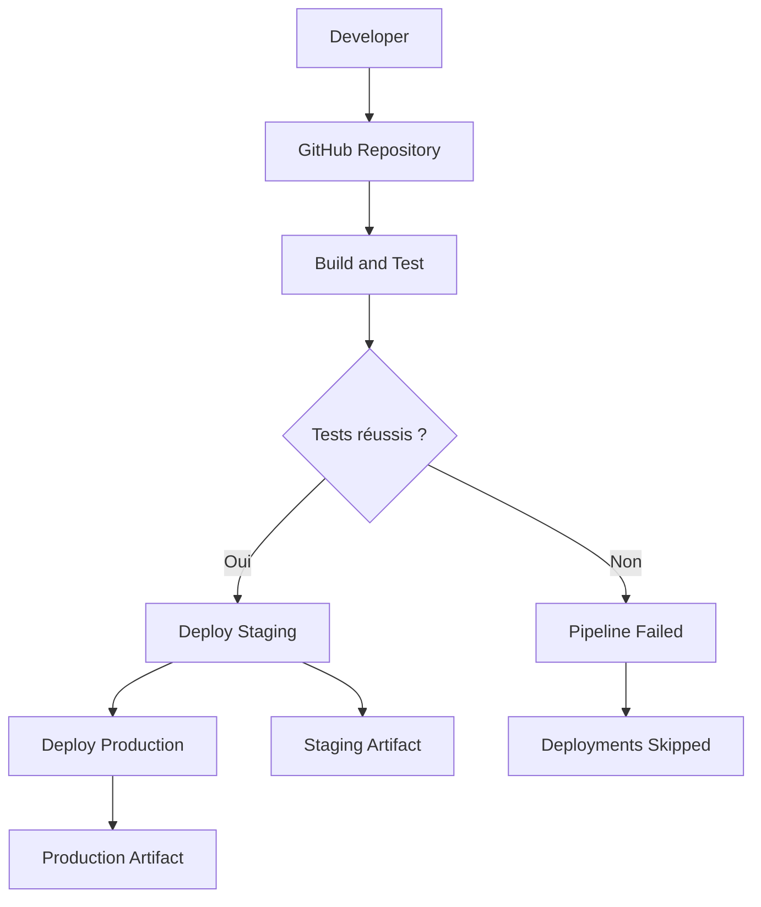

# TP2 DevOps — Simulation d’un pipeline CI/CD avec GitHub Actions

**Ayoub AMEUR** · Université Sidi Mohamed Ben Abdellah · ENSA Fès

ILIA, semestre 5 · Module DevOps · Année universitaire 2026–2027

## Présentation et objectifs pédagogiques

Ce TP suit une modification du code depuis un commit Git jusqu’à la publication de deux artefacts. L’objectif est de tester une application Python, de conditionner chaque déploiement à la réussite du job précédent et d’observer l’effet d’une erreur puis de sa correction.

## Application et architecture du projet

`calculer_moyenne(notes)` calcule la moyenne arithmétique. Une liste vide lève une exception `ValueError` avec le message « La liste des notes est vide ». La fonction `mention(moyenne)` applique le barème ci-dessous et `est_admis(moyenne)` renvoie `True` dès 10 de moyenne.

| Moyenne | Mention |
|---|---|
| Moins de 10 | Ajourné |
| De 10 inclus à 12 exclu | Passable |
| De 12 inclus à 14 exclu | Assez bien |
| De 14 inclus à 16 exclu | Bien |
| À partir de 16 | Très bien |

```text
TP-Simulation-CICD/
├── .github/
│   └── workflows/
│       └── cicd.yml       # Définition du pipeline
├── app.py                 # Calcul de la moyenne, mention et admission
├── test_app.py            # Quatre tests unitaires
├── requirements.txt       # Dépendance de test : pytest
├── .gitignore             # Exclusions Git
└── README.md
```

## Installation locale et tests unitaires

Depuis le répertoire du projet, créer et activer un environnement virtuel avec Python 3.12.

**macOS (zsh ou Bash)**

```bash
python3.12 -m venv venv
source venv/bin/activate
```

**Windows (invite de commandes)**

```bat
py -3.12 -m venv venv
venv\Scripts\activate.bat
```

**Dans les deux environnements**

```sh
python -m pip install -r requirements.txt
python -m pytest -v
```

Les quatre tests vérifient la moyenne de `[12, 14, 16]`, le cas de la liste vide, les cinq mentions et les deux décisions d’admission.

## Architecture du pipeline CI/CD

Le workflow YAML **Pipeline CI-CD Python** s’exécute à chaque push sur `main`, à chaque pull request ciblant `main` et sur lancement manuel depuis l’onglet **Actions** de GitHub. Chaque job dispose de son propre runner Ubuntu.



| Job | Condition de démarrage | Opération |
|---|---|---|
| Build and Test | Déclenchement du workflow | Récupère le code avec Git, installe Python 3.12 et pytest, puis lance `pytest -v`. |
| Deploy Staging | Réussite de Build and Test | Un script Bash écrit `Version de test de l'application` dans `staging/app.txt`. Le job publie le dossier sous le nom `application-staging`. |
| Deploy Production | Réussite de Deploy Staging | Un script Bash écrit `Version stable de l'application` dans `production/app.txt`. Le job publie le dossier sous le nom `application-production`. |

L’**intégration continue** (CI) vérifie automatiquement chaque modification couverte par le workflow. La **livraison continue** prépare une version validée pour une mise en production. Le **déploiement continu** automatise également cette dernière étape. Ici, staging et production sont simulés par deux fichiers texte téléchargeables depuis le résumé de l’exécution. Aucun serveur externe ne reçoit l’application.

### Mots-clés GitHub Actions

| Mot-clé | Rôle dans le TP |
|---|---|
| `name` | Nomme le workflow, un job ou une étape dans l’interface. |
| `on` | Déclare les événements déclencheurs. |
| `push` | Réagit aux commits poussés sur `main`. |
| `pull_request` | Réagit notamment à l’ouverture ou à la mise à jour d’une pull request ciblant `main`. |
| `workflow_dispatch` | Permet de lancer le workflow manuellement. |
| `jobs` | Regroupe les trois jobs du pipeline. |
| `runs-on` | Sélectionne le runner `ubuntu-latest`. |
| `steps` | Ordonne les étapes à exécuter dans un job. |
| `uses` | Appelle une action réutilisable, par exemple `actions/upload-artifact@v4`. |
| `run` | Exécute des commandes shell sur le runner. |
| `needs` | Déclare le job préalable dont la réussite conditionne le démarrage du job courant. |
| `with` | Fournit les paramètres d’une action, par exemple la version de Python ou le chemin des fichiers. |

## Simulation d’une erreur et reprise

1. **A — Version initiale.** Pousser sur `main` le test qui attend une moyenne de 14. Ouvrir l’exécution correspondant au commit dans **Actions**, puis vérifier les trois jobs et télécharger les deux artefacts.
2. **B — Erreur volontaire.** Dans `test_calculer_moyenne`, remplacer uniquement la valeur attendue `14` par `20`. Exécuter `python -m pytest -v`, commiter et pousser. La moyenne calculée vaut toujours 14. L’assertion échoue et pytest renvoie un code de sortie non nul. Avec `needs: build-test`, staging est ignoré. Avec `needs: deploy-staging`, production est ignorée à son tour. Les étapes de publication sont donc inaccessibles.
3. **C — Correction.** Rétablir `14`, relancer les tests, commiter et pousser. Ce nouveau commit déclenche une exécution distincte. L’exécution en échec reste consultable dans l’historique.

## Résultats obtenus

Lors de la première exécution locale sous macOS avec Python 3.12.16 et pytest 9.2.0, les quatre tests ont réussi.

## Conclusion

Les dépendances entre jobs imposent l’ordre de livraison. Une assertion incorrecte suffit à bloquer les deux publications. Sa correction permet de reprendre le même parcours depuis les tests.
